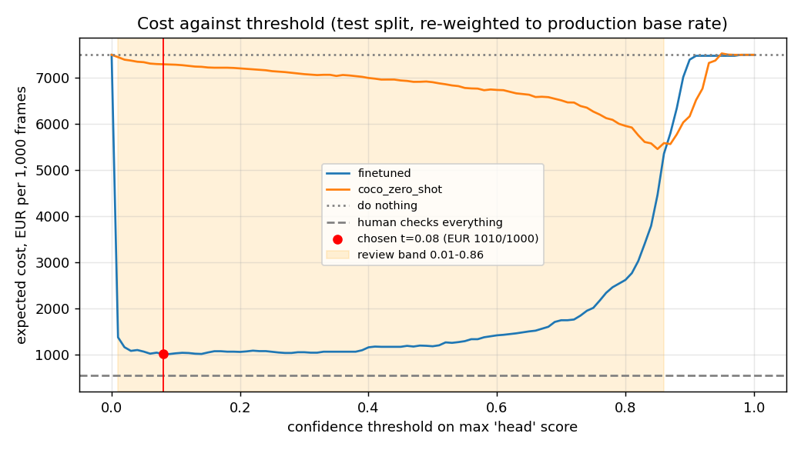

# Assignment 2 Report

- Name: Juan Jacobo Rico Fontán
- Student ID: 18693
- Email: jrico.ieu2022@student.ie.edu
- Group: BBADBA 5B

## Business problem, and the cost of being wrong

The decision I chose is whether a worker on a construction site is wearing a hard hat. Today a site supervisor walks around and checks this by eye. The idea is to use the cameras that are already on site so a model looks at each frame and decides between three outcomes: let it pass, send it to a person at a safety desk to check, or alert the supervisor so he goes to the worker and stops the job until the helmet is on. I assume a medium site with 10 cameras taking one frame every two minutes during a 10-hour shift, which gives about 3,000 frames a day.

A frame counts as positive (a violation) if it shows at least one head without a helmet. The score of a frame is the highest confidence the model gives to any "head" in it, since one worker without a helmet is enough.

The two mistakes do not cost the same. Missing a worker without a helmet can lead to a fine from the labour inspection, which in Spain starts at around 2,451 euros for a serious safety breach, and in the worst case to an injury. Not every missed case ends in a fine or an accident, so I estimated that roughly one in sixteen would, which gives about 150 euros per missed frame. A false alarm is much cheaper: the supervisor loses about ten minutes walking over, which at 45 euros an hour is 7.50 euros. A correct alarm costs the same walk. Having someone at the desk look at a frame takes about 20 seconds, which at 30 euros an hour is 0.17 euros.

So a miss costs about twenty times more than a false alarm, which means the model should rather raise too many alarms than too few. At the same time, a quick check at the desk is much cheaper than sending the supervisor, so frames the model is unsure about should go to a person first.

I also had to assume how often violations actually happen. I used 5% of frames. Most workers do wear their helmet, but people take it off during breaks or for short jobs. The test set has a much higher share (19%), so I did not use its mix directly. Instead I measured how the model behaves on violations and on normal frames separately, and then weighted those results to 5%.

## Dataset

I used the Roboflow Universe dataset from workspace computer-vision-filqz, project hard-hat-detection-62rrp, version 2 (https://universe.roboflow.com/computer-vision-filqz/hard-hat-detection-62rrp/dataset/2). It is a public copy of the Hard Hat Workers dataset from Northeastern University (China), with 7,035 images under a CC BY 4.0 licence, and I used it as published without forking it.

Each image shows one or more workers, mostly on construction sites. There are three classes: head (a head without a helmet), helmet (a head with a helmet) and person. The dataset fits the problem because it labels exactly the difference the decision depends on, a bare head versus a head with a helmet, and every worker wearing a helmet gives the model a useful example of what is not a violation.

## What the dataset's composition implies

| split | images | head | helmet | person | images with a head |
|---|---|---|---|---|---|
| train | 4,516 | 4,089 | 12,750 | 423 | 831 |
| valid | 753 | 785 | 2,134 | 50 | 137 |
| test | 1,766 | 1,803 | 4,863 | 142 | 339 |

This version only came with a train and a test split, so I moved every seventh training image into a validation set. Validation is only used during training to decide when to stop, so the test set stays untouched.

There are about three helmets for every head, so heads are the smaller class, but with 1,803 heads in the test set the results for that class are reliable. The person class is a different story. It only has 142 examples in the test set and it is labelled inconsistently, since most workers have a head or helmet box but no person box. I expected the model to do badly on it and I do not use it for the decision.

The objects are small. A typical head takes up about 0.6% of the image, and on a real site camera placed high up they would be even smaller, so the results on the test set are probably better than what the model would get in practice. The test images are also mostly close-up photos rather than footage from a fixed camera, and they contain far more violations than a real site. I correct for the second problem with the 5% assumption, but not for the first one.

## Finetuning and baselines

I treated this as object detection rather than classification, because a frame often shows several workers and the model needs to find the one who is not wearing a helmet. I fine-tuned yolo11s, starting from the version pretrained on COCO. I picked the small model rather than the nano one because the heads are small and the extra capacity does not cost much at 3,000 frames a day. I trained on Google Colab with a T4 GPU for 40 epochs, image size 640, batch 16, early stopping after 10 epochs without improvement, and seed 0.

I compared it on the same test images with two baselines. The first is the original COCO model without any fine-tuning. COCO has no head or helmet class, so the only thing it can detect here is a person, which in practice means raising an alarm whenever it sees someone. The second is a trivial model that never predicts anything, which is the same as doing nothing. Predicting the majority class gives the same result, because most test frames have no violation.

| model | mAP50 | mAP50-95 | head AP50 | helmet AP50 | person AP50 | cost per 1,000 frames |
|---|---|---|---|---|---|---|
| fine-tuned yolo11s | 0.659 | 0.475 | 0.970 | 0.981 | 0.026 | 1,010 € |
| COCO without fine-tuning | 0.009 | 0.006 | 0.000 | 0.000 | 0.026 | 5,457 € |
| predict nothing | 0.000 | 0.000 | 0.000 | 0.000 | 0.000 | 7,500 € |

The fine-tuned model beats both baselines clearly. The COCO model scores zero on heads and helmets simply because it never learned those classes, and seeing a person turned out to be a weak sign that someone is missing a helmet. The gap was bigger than I expected: going from the COCO model to the fine-tuned one cuts the expected cost from about 5,460 to about 1,010 euros per thousand frames.

## Per-class evaluation and failure modes

The class I treat as positive is head. Looking at boxes with a confidence of at least 0.25, the model finds 95.7% of the heads and 90.3% of its head predictions are correct. Helmets are slightly better (96.3% found, 91.8% correct). Person is close to zero, as expected.

| actual / predicted | head | helmet | person | missed |
|---|---|---|---|---|
| head | 1,722 | 21 | 0 | 60 |
| helmet | 13 | 4,683 | 0 | 167 |
| person | 0 | 0 | 0 | 142 |
| background | 176 | 396 | 0 | |

The overall mAP50 of 0.66 looks average, but that is because the person class pulls it down. The number that matters for the decision is the head score of 0.97, and helmets carry the rest.

The mistake that costs money is when a bare head is taken for a helmet, because then the violation is missed. That happened 21 times out of 1,803. Looking at the type of images, these are probably caps, hoods or hair in helmet-like colours. Another 60 heads were not detected at all, mostly small or partly hidden ones, which is the problem I expected from the small object sizes. The model also drew 176 head boxes where nothing was labelled, for example people in the background who were not annotated. Those turn into false alarms or extra checks at the desk.

## Cost matrix and operating point

Using the costs above and a 5% violation rate, I calculated the expected cost per thousand frames for every threshold between 0 and 1, assuming the model decides on its own and raises an alarm whenever the score is above the threshold.

The cheapest threshold is 0.08, which costs about 1,010 euros per thousand frames compared with 7,500 for doing nothing. At that point the model catches about 96% of the frames with a violation and raises a false alarm on about 4.5% of the normal ones, which means around 7 missed violations and 128 unnecessary trips for the supervisor each day. The threshold is low because a miss is twenty times more expensive than a false alarm, so the model should already raise an alarm when it is only slightly suspicious. The curve is quite flat between about 0.03 and 0.40, so the exact value inside that range does not change much.

The number I am least sure about is the 150 euros for a missed violation, so I recalculated the best threshold with other values. If a miss cost only 25 euros, the best threshold would move up to 0.54, and if it cost 300 euros or more it would drop to 0.03. The violation rate has a similar effect: at 1% the best threshold is 0.50 and at 10% it is 0.03. In every case the model is much cheaper than doing nothing, so that conclusion holds, but the exact threshold depends on these two assumptions and I would adjust it once there is real data from the site.

## What a person still has to check

With three outcomes there are two thresholds. Frames below the lower one pass, frames above the upper one go straight to the supervisor, and frames in between go to the safety desk. I tried every combination of the two thresholds and kept the cheapest one that a single person at the desk can handle, assuming about six and a half hours of real work a day at 20 seconds per frame.

The result is a lower threshold of 0.01 and an upper threshold of 0.86. About 14% of frames go to the desk, which is around 430 frames a day or about two and a half hours of work, so one person can do it comfortably. Frames above 0.86 are all real violations in the test set, so the supervisor is never sent for nothing. Overall about 2.4% of violations still pass without anyone noticing, which is around 3 or 4 a day.

| option | cost per 1,000 frames | cost per day | people at the desk | missed per day |
|---|---|---|---|---|
| do nothing | 7,500 € | 22,500 € | 0 | 150 |
| a person checks every frame | 542 € | 1,625 € | 2.6 | 0 |
| model decides alone (0.08) | 1,010 € | 3,029 € | 0 | 7 |
| model plus desk (0.01 / 0.86) | 567 € | 1,702 € | 0.4 | 3.5 |

One result surprised me. With my numbers, having a person look at every single frame is about 77 euros a day cheaper than the model with the desk, because a 20-second check is so cheap. But that option needs between two and three full-time people looking at 3,000 frames a day, almost all of them showing nothing wrong, and it only works if they never miss anything. If those people missed more than about 1 in 90 violations, the combination of model and desk would already be cheaper, and I think that is very likely with that much repetitive work. With the model, the person at the desk only sees about 430 frames a day and roughly a quarter of them are real violations, so it is easier to stay focused.

For that reason I would use the model with the desk and one person, and check during the first month how accurate that person really is. Letting the model decide alone is the worst of the options that involve the model, at about 1,300 euros a day more.

## Limitations & next steps

The biggest limitation is that the test images do not look like real site footage. They are mostly close-up photos, while a real camera would be fixed and high up, with smaller heads. Before using this on a real site I would label a few hundred frames from the actual cameras and choose the thresholds again on those.

I also counted each frame separately, but a worker without a helmet appears in several frames in a row, so the same violation is counted more than once. Following each person across frames and counting each episode once would give a more honest cost.

I assumed the person at the desk never makes a mistake, and as shown above that assumption decides which option is cheaper, so it should be measured, for example by adding a few known violations to the queue and seeing how many are caught. The 150 euros per miss is an estimate and should be replaced with the company's own history of fines and incidents.

Finally, the model misses some very small heads, which could be improved by training at a higher resolution, and the person class should either be relabelled or removed, since it does not help with the decision.

## Generative AI use disclosure

I used Claudes help with this assignment for various steps. Firstly, he helped me with the correct and full setup of the assignment, as well as he will help me with the submission. Claude algo aided me in the decision of the selection of the topic, as there where several possible options that could have been used, but we both agreed to choose this one. He then helped me implementing the correct code, giving me possible attack ways and coding most of the project. This didn’t mean it was done by him, as the decisions, the critical steps such as the decision of the models, was done by me, but coded by Claude. Meaning he just followed my guide. Finally, he helped me extract the most useful results for the report, paraphrased and corrected many mistakes I had in my text, and helped me format the doc I had originally made into .md format.
